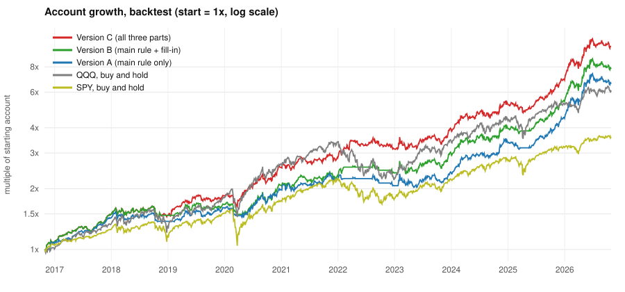
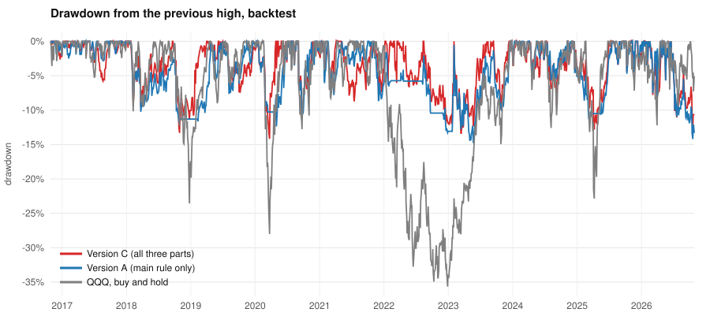

# US large-cap stock strategy — backtest results

A rules-based, long-only strategy on large US stocks. It trades on 4-hour, 2-hour and daily bars and uses a market filter that moves the account to cash in weak markets.

**This page shows backtest results only.** The rules and the code are kept private.

**These are hypothetical results from a backtest, not from a live account. Nothing here is investment advice.**

## Summary

27 October 2016 to 27 October 2026 (10 years), starting account 50,000 USD, no leverage, no short selling.

| | Return per year | Largest drawdown | Account multiple | Sharpe ratio | Worst calendar year |
|---|---|---|---|---|---|
| **Version A** — main rule only | 20.8% | 16.2% | 6.6x | 1.29 | -7.3% (2022) |
| **Version B** — main rule + fill-in rule | 22.8% | 15.9% | 7.8x | 1.33 | -0.8% (2018) |
| **Version C** — main rule + fill-in rule + rebound rule | 26.0% | 15.0% | 10.1x | 1.41 | -0.9% (2018) |
| QQQ, buy and hold | 19.9% | 35.6% | 6.1x | 0.92 | -33.0% (2022) |
| SPY, buy and hold | 13.7% | 34.2% | 3.6x | 0.80 | -19.5% (2022) |

Version A is the baseline. The two add-on rules in versions B and C are still under evaluation.

QQQ and SPY are price only; their dividends are not included. The Sharpe ratio uses daily returns and a zero risk-free rate.

## Account growth

## Drawdown

## Returns by year

| Year | Version A | Version B | Version C | QQQ | SPY |
|---|---|---|---|---|---|
| 2016 (from 27 Oct) | +7.1% | +8.2% | +8.2% | +0.5% | +4.9% |
| 2017 | +33.7% | +37.6% | +37.6% | +31.4% | +19.4% |
| 2018 | -3.7% | -0.8% | -0.9% | -1.0% | -6.3% |
| 2019 | +16.8% | +13.5% | +25.2% | +37.8% | +28.7% |
| 2020 | +23.0% | +24.6% | +38.2% | +47.5% | +16.1% |
| 2021 | +12.8% | +10.7% | +11.5% | +26.8% | +27.0% |
| 2022 | -7.3% | +3.7% | +10.5% | -33.0% | -19.5% |
| 2023 | +16.8% | +25.8% | +26.0% | +53.8% | +24.3% |
| 2024 | +39.5% | +31.4% | +31.4% | +24.8% | +23.3% |
| 2025 | +32.2% | +36.6% | +32.5% | +20.2% | +16.4% |
| 2026 (to 27 Oct) | +47.9% | +44.5% | +46.5% | +17.4% | +12.9% |

The strategy lagged QQQ in strong years (2019, 2020, 2021, 2023) and lost far less in 2022.

## Trades

| | Version A | Version B | Version C |
|---|---|---|---|
| Closed trades | 364 | 433 | 583 |
| Winning trades | 48.6% | 49.9% | 51.8% |
| Average winning trade | +18.2% | +16.7% | +15.2% |
| Average losing trade | -6.4% | -6.3% | -6.7% |
| Average trade | +5.6% | +5.1% | +4.6% |
| Average holding time | 71 days | 64 days | 51 days |
| Average share of the account in cash | 22.8% | 18.8% | 15.5% |
| Months with a gain | 60% | 62% | 68% |
| Best month / worst month | +14.9% / -10.8% | +15.1% / -10.8% | +17.0% / -10.7% |
| Longest time below a previous high | 530 trading days | 161 trading days | 161 trading days |

## How the backtest was run

- **Stocks:** members of the S&P 500 and the Nasdaq-100, plus companies with a market cap above 50 billion USD, as they were at each date (reconstructed approximately).
- **Prices:** real 4-hour, 2-hour and daily bars. A signal uses completed bars only and is filled at the open of the next bar.
- **Position size:** 10% of the account per stock in the main rule, at most nine stocks at a time, with a small cash reserve. Cash earns no interest.
- **Costs:** 0.1% of the trade value on every buy and every sell.
- **Checks:** the two add-on rules were each checked by an independent second program that re-derived every fill; it found no differences in the runs checked.

With index members only (no extra 50-billion companies) the results are 21.0% / 24.9% / 27.3% a year for versions A / B / C, with drawdowns of 15.5% / 15.5% / 14.8%.

## Could these trades have been made at the time?

As far as the choice of stocks goes, yes. The backtest does not start from a list of stocks that are known today to have become big winners.

- **The stock list is rebuilt for every date.** On each day the strategy may only buy stocks that were members of the S&P 500 or the Nasdaq-100 on that day. 754 companies were members at some point in the ten years. 175 of them were later removed, acquired or delisted; they are in the test for the time they were members, losses included.
- **A later winner is not available early.** A stock that joined an index in 2025 cannot be bought in the test before the day it joined, however much it rose before that.
- **Signals use past prices only.** Every buy and sell is decided on completed bars and filled at the open of the next bar.
- **One exception, shown separately.** The extra companies above 50 billion USD were taken from companies that are above 50 billion today, each counted from the date its market cap first passed 50 billion. A company that was above 50 billion in the past and has since fallen below is missing, so this part contains some hindsight. It accounts for 34 of the 591 trades in version C and about 3% of its profit. The results with index members only do not have this issue; they are given above and are slightly higher.

This covers the choice of stocks only. The rules themselves were developed on the same ten years, as described below.

## Limits of these results

- **Backtest, not a track record.** No real money was traded on these rules over this period.
- **Developed on the same period.** The rules were built using these ten years of data, so there is no separate period that the rules had never seen. Real results are usually lower than backtests of this kind.
- **Approximate history of the stock list.** Index membership and market caps at past dates were reconstructed and are not exact.
- **The rebound rule rests on few episodes.** It acted in only 8 market periods in ten years, and two of them (March 2020 and February 2022) produced essentially all of its profit; the other six together made about zero.
- **Small differences are noise.** Changing the position size or the order in which simultaneous signals are bought moves the result by a point or two a year.
- **Not included:** taxes, slippage beyond the 0.1% cost, and dividends on the benchmarks.

## Data files

- [`data/yearly_returns_percent.csv`](data/yearly_returns_percent.csv) — the table above.
- [`data/account_curve_version_A.csv`](data/account_curve_version_A.csv), [`B`](data/account_curve_version_B.csv), [`C`](data/account_curve_version_C.csv) — daily account value as a multiple of the starting account.
- The same three curves for index members only: `data/account_curve_version_*_index_members_only.csv`.

## Option tests

Results of option tests on real option prices are on a separate page: [OPTIONS.md](OPTIONS.md). Rules are not shown there either.
